# Public Transport Monitor

Assignment 6 - Observer and Visitor patterns, Clean Code ch. 11-13. Variant 15: public transport.
Java 17, JUnit 5, no other libraries.

A live telemetry side (Observer) reacts to GPS and turnstile events, and a stable tree of the city
transport network (Visitor) is analysed by separate operations. A serious delay on a route triggers
an emergency inspection of that route's subtree only, and the result comes back into the system as a
`MaintenanceTicket` event.

## Build, test, run

```
mvn test                                  # 22 JUnit 5 tests
mvn package
java -cp target/classes transport.Main    # demo: producers -> listeners -> tickets, then tree analysis
```

## Project layout

```
src/main/java/transport/
  domain/event/    TransportEvent (sealed), EventType, DelaySeverity, VehicleLocationEvent,
                   DelayDetectedEvent, PassengerBoardingEvent, HourlyTrafficReportEvent, MaintenanceTicket
  domain/tree/     TransportElement, NetworkComposite, RouteComposite, BusLeaf, TramLeaf,
                   PhysicalStationLeaf, ChargingHubLeaf, FerryLeaf, EngineType
  observer/        Subject, Observer, BaseSubject
  observer/sources GpsTelemetrySource, TurnstileSensorSource
  observer/listeners StopDisplayBoard, PassengerMobileAppNotifier, PassengerFlowAuditor, RidershipAggregator
  visitor/         TransportVisitor, FleetOperatingCostVisitor, NetworkCensusVisitor,
                   AccessibilityAuditVisitor, TransportNetworkJsonExportVisitor,
                   RouteEmergencyInspectionVisitor, EmissionAuditVisitor
  service/         IntegrationManager, DelayAlertService
  Main.java        composition root
```

## UML class diagram

```mermaid
classDiagram
    direction LR

    class TransportEvent {
        <<sealed interface>>
        +type() EventType
        +timestamp() Instant
    }
    class VehicleLocationEvent
    class DelayDetectedEvent
    class PassengerBoardingEvent
    class HourlyTrafficReportEvent
    class MaintenanceTicket
    TransportEvent <|.. VehicleLocationEvent
    TransportEvent <|.. DelayDetectedEvent
    TransportEvent <|.. PassengerBoardingEvent
    TransportEvent <|.. HourlyTrafficReportEvent
    TransportEvent <|.. MaintenanceTicket

    class Observer~E~ {
        <<interface>>
        +onUpdate(E event)
    }
    class Subject~E~ {
        <<interface>>
        +subscribe(EventType, Observer)
        +unsubscribe(EventType, Observer)
        +notify(E event)
    }
    class BaseSubject~E~ {
        -observersByType : ConcurrentHashMap of CopyOnWriteArrayList
    }
    Subject <|.. BaseSubject

    class GpsTelemetrySource {
        +reportLocation(...)
        +reportDelay(...)
    }
    class TurnstileSensorSource {
        +registerBoarding(...)
    }
    BaseSubject <|-- GpsTelemetrySource
    BaseSubject <|-- TurnstileSensorSource

    class StopDisplayBoard
    class PassengerMobileAppNotifier
    class PassengerFlowAuditor
    class RidershipAggregator {
        +publishReport()
    }
    class DelayAlertService {
        -network : NetworkComposite
    }
    Observer <|.. StopDisplayBoard
    Observer <|.. PassengerMobileAppNotifier
    Observer <|.. PassengerFlowAuditor
    Observer <|.. RidershipAggregator
    Observer <|.. DelayAlertService
    BaseSubject <|-- RidershipAggregator
    BaseSubject <|-- DelayAlertService

    class TransportElement {
        <<interface>>
        +accept(TransportVisitor) R
    }
    class NetworkComposite
    class RouteComposite
    class BusLeaf
    class TramLeaf
    class PhysicalStationLeaf
    class ChargingHubLeaf
    class FerryLeaf
    TransportElement <|.. NetworkComposite
    TransportElement <|.. RouteComposite
    TransportElement <|.. BusLeaf
    TransportElement <|.. TramLeaf
    TransportElement <|.. PhysicalStationLeaf
    TransportElement <|.. ChargingHubLeaf
    TransportElement <|.. FerryLeaf
    NetworkComposite o-- RouteComposite
    RouteComposite o-- TransportElement

    class TransportVisitor~R~ {
        <<interface>>
        +visit(NetworkComposite) R
        +visit(RouteComposite) R
        +visit(BusLeaf) R
        +visit(TramLeaf) R
        +visit(FerryLeaf) R
        +visit(PhysicalStationLeaf) R
        +visit(ChargingHubLeaf) R
    }
    class FleetOperatingCostVisitor
    class NetworkCensusVisitor
    class AccessibilityAuditVisitor
    class TransportNetworkJsonExportVisitor
    class RouteEmergencyInspectionVisitor
    class EmissionAuditVisitor
    TransportVisitor <|.. FleetOperatingCostVisitor
    TransportVisitor <|.. NetworkCensusVisitor
    TransportVisitor <|.. AccessibilityAuditVisitor
    TransportVisitor <|.. TransportNetworkJsonExportVisitor
    TransportVisitor <|.. RouteEmergencyInspectionVisitor
    TransportVisitor <|.. EmissionAuditVisitor
    TransportElement ..> TransportVisitor : double dispatch

    class IntegrationManager {
        +startSimulation(routeIds, eventsPerProducer)
        +submit(Runnable)
        +shutdownGracefully() boolean
    }
    IntegrationManager --> GpsTelemetrySource : feeds
    IntegrationManager --> TurnstileSensorSource : feeds
    DelayAlertService --> NetworkComposite : finds RouteComposite
    DelayAlertService ..> RouteEmergencyInspectionVisitor : runs on subtree
    RouteEmergencyInspectionVisitor ..> MaintenanceTicket : produces
```



Integration link: `GpsTelemetrySource` -> `DelayAlertService` (Observer side) -> `RouteEmergencyInspectionVisitor`
(Visitor side) -> `MaintenanceTicket` published again by `DelayAlertService` to its own subscribers.

## Design decisions

### Observer

**Push, not pull.** A source hands every listener an immutable event record (`onUpdate(E event)`).
Listeners need to react to a specific delay, accident or boarding right away and the event already
contains everything they need. With pull, each listener would have to query the source for its state
after every notification, which adds repeated calls, needs the source to expose mutable state, and
can read a state that has already changed by the time the listener asks. Records make the pushed
data safe to share between threads.

**Generic, typed subjects.** `Subject<E extends TransportEvent>` is parameterised with the event
family the source emits: `TurnstileSensorSource` is a `Subject<PassengerBoardingEvent>`,
`RidershipAggregator` a `Subject<HourlyTrafficReportEvent>`, `DelayAlertService` a
`Subject<MaintenanceTicket>`. `GpsTelemetrySource` emits two kinds of event, so it is a
`Subject<TransportEvent>` and its listeners pattern-match on the sealed hierarchy.

**Registry without a global lock.** `BaseSubject` keeps a `ConcurrentHashMap<EventType,
CopyOnWriteArrayList<Observer<E>>>`. `notify` iterates a snapshot of the list, so a listener can
subscribe or unsubscribe (including itself, from inside `onUpdate`) while other threads publish:
no `ConcurrentModificationException`, no lost delivery to the other listeners, and no lock on the
whole subject. The price is that a listener removed during a notification round may still receive
the event of that round, and that writes copy the list, which is fine because subscribing is rare
and publishing is frequent.

**Chain of observers.** `RidershipAggregator` is an `Observer<PassengerBoardingEvent>` and a
`Subject<HourlyTrafficReportEvent>`. It accumulates passengers per route and `publishReport()` drains
the counters key by key with `ConcurrentHashMap.remove`, so boardings arriving during the drain land
either in this report or in the next one and are never lost.

### Visitor

**Double dispatch.** `TransportVisitor<R>` has one overloaded `visit(...)` per element type. Java
resolves overloads at compile time from the static type, so `visitor.visit(node)` with
`node : TransportElement` would not compile. `node.accept(visitor)` is the first dispatch (runtime
type of the element picks the `accept` implementation) and `visitor.visit(this)` inside it is the
second (the static type of `this` is now the concrete class, so the right overload is chosen).

**Traversal lives in the visitors.** Elements are immutable records that hold data only and
`accept` just forwards to `visit`. Each operation combines child results in its own way: a sum
for cost, a running state for the census, a concatenated list for the audit, indented text for
JSON, collected findings for the inspection. Putting the loop in the tree would force one
traversal shape on all of them. It also lets `RouteEmergencyInspectionVisitor` run on a single
`RouteComposite` simply by calling `route.accept(visitor)`. The cost is a one-line child loop in
each visitor's composite methods.

**The four required visitors.** `FleetOperatingCostVisitor` (numeric, `Double`),
`NetworkCensusVisitor` (state accumulator, returns `NetworkCensus`), `AccessibilityAuditVisitor`
(filter, returns `List<PhysicalStationLeaf>`) and `TransportNetworkJsonExportVisitor` (hand-written
JSON, escapes strings, no libraries). Stateful visitors are single-use: create one per run.

### Integration

`DelayAlertService` listens to `DELAY_DETECTED`. For `CRITICAL_DELAY` and `ACCIDENT` it finds the
`RouteComposite` with the event's route id, runs `RouteEmergencyInspectionVisitor` on that subtree
only (worn buses, tram pantographs and overloaded charging hubs of that route become findings) and
publishes the resulting `MaintenanceTicket`. Minor delays and unknown routes are ignored.

### Concurrency

`IntegrationManager` owns a fixed thread pool whose size is a constructor argument. `startSimulation`
runs three independent producers (telemetry, ticket validation, schedule failures). Shared state is
a `ConcurrentHashMap` (`merge` is atomic) or a copy-on-write list. `shutdownGracefully()` calls
`shutdown()`, waits `awaitTermination(5, SECONDS)`, and only on timeout calls `shutdownNow()` and
waits again, so queued producers finish and no events are lost.

### Clean Code

One composition root (`Main`), constructor injection only (including the `Clock` used for event
timestamps), no singletons, no `getInstance()`, no lazy initialisation. Magic numbers are named
constants. Records for events and tree nodes remove boilerplate and make them immutable.

## Trade-off proof

### Commit 7 - new visitor, no element touched

Added `EmissionAuditVisitor` (carbon footprint in kg CO2). Files changed (2, both new):

- `src/main/java/transport/visitor/EmissionAuditVisitor.java`
- `src/test/java/transport/visitor/EmissionAuditVisitorTest.java`

No class in `domain/tree` and no existing visitor was modified. A new operation over the tree costs
one new class, which is the strength of Visitor when operations change often and the structure is stable.

### Commit 8 - new element, every visitor touched

Added `FerryLeaf` (river tram). Files changed (9):

- new: `src/main/java/transport/domain/tree/FerryLeaf.java`
- modified: `visitor/TransportVisitor.java` (new `visit(FerryLeaf)`)
- modified, forced by the interface change: `FleetOperatingCostVisitor`, `NetworkCensusVisitor`,
  `AccessibilityAuditVisitor`, `TransportNetworkJsonExportVisitor`, `RouteEmergencyInspectionVisitor`,
  `EmissionAuditVisitor`
- new test: `src/test/java/transport/visitor/FerryLeafTest.java`

Adding one element type changes the visitor interface and therefore every visitor, 7 files edited
for 1 new class, and the number grows with each new visitor. The compiler finds every place that was
missed, which is useful, but the change is not local. I would reject Visitor when the element
hierarchy changes more often than the set of operations (for example a catalogue that gets a new
vehicle type every sprint), and use plain polymorphic methods on the elements instead.

## Tests (22, JUnit 5)

| Group | Tests | What they check |
|---|---|---|
| Observer | 9 | subscribe/unsubscribe per event type, event-type isolation, self-unsubscribe inside `onUpdate`, `RidershipAggregator` chain and interval reset, display board ETA, notifier text, flow auditor |
| Visitor | 8 | cost against hand calculation (network and subtree), census, accessibility filter, JSON validity and nesting (checked with a strict parser written for the tests), emission audit, ferry support in existing visitors |
| Integration | 2 | delay event -> route subtree inspection -> `MaintenanceTicket`; minor delay, unknown route and accident cases |
| Concurrency | 3 | 4 threads x 1000 events = exactly 4000 delivered; subscribe/unsubscribe during publishing loses nothing; graceful shutdown finishes queued producers and rejects new ones |

Hand-calculated values are written next to the assertions (for example total fleet cost 238 200,
census 5 vehicles / 540 seats / 62.5 % average pantograph wear).

## Commit history

1. Observer core: `Subject`, `Observer`, `EventType`, event records, thread-safe registry
2. Visitor hierarchy: Composite tree and `TransportVisitor<R>`
3. Visitor operations: cost, census, accessibility audit, JSON export, tests
4. Sources and listeners: GPS, turnstile, display board, notifier, flow auditor, ridership aggregator
5. Concurrency layer: executor producers, graceful shutdown, 4 x 1000 stress test
6. Integration link: `DelayAlertService` + `RouteEmergencyInspectionVisitor`, composition root
7. Trade-off: new `EmissionAuditVisitor`
8. Trade-off: new `FerryLeaf`
9. Documentation: README and UML

## Known limitations

- A listener that throws stops delivery to the listeners after it in that round; exceptions are not isolated per listener.
- The report interval is triggered by calling `RidershipAggregator.publishReport()`; the demo calls it once after the producers stop.
- Event data is simulated by deterministic producers, not real GPS or turnstile hardware.
